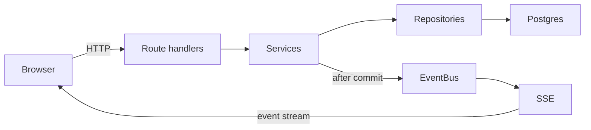

# Kanban Board

## Overview

A collaborative Kanban board with cards, columns, members, and activity history.
Changes appear in other open sessions through Server-Sent Events (SSE).
Live demo: `<LIVE_URL>`. The first visit after a free-tier idle period can take about a minute.

## Features

| Assignment requirement | Implementation |
| --- | --- |
| Authentication | Register, sign in, and sign out. Protected pages and APIs use a session cookie. |
| Shared boards | Create, list, rename, and delete boards. Add members by email. Only the owner can delete the board. |
| Columns and cards | Manage columns and cards, set priority and assignee, and reorder cards with pointer, touch, or keyboard. |
| Search and filters | Search titles and descriptions and filter by assignee or priority. The URL preserves the filters. |
| Collaboration | Two open sessions receive committed changes without a reload. Activity history shows who changed what. |
| Request protection | Validate input, enforce board membership, and apply per-user request quotas. |

For keyboard drag, focus the card’s **Reorder** button. Press Space to pick up, use the arrows to move, press Space to drop, or press Escape to cancel.

## Tech stack

- **Next.js App Router, React, TypeScript** for pages and Node route handlers in one application.
- **PostgreSQL, Prisma, node-postgres** for relational constraints, migrations, and transactions.
- **TanStack Query and SSE** for the client cache and live updates.
- **dnd-kit and fractional-indexing** for accessible drag controls and ordered positions.
- **Zod, bcrypt, jose** for input validation, password hashing, and session signing. CSS Modules and tokens define the UI. Vitest covers units and Postgres integration.

## Architecture



Routes authenticate, validate input, call services, and return DTOs. Services
enforce business rules and control transactions through repository interfaces.
Repositories own database access. Shared contracts are framework-independent.
UI features use the HTTP client and shared contracts. The ESLint config enforces
import boundaries.

## Key decisions

- [Fractional indexing](docs/decisions.md#adr-007--fractional-ordering) uses unique position keys within each parent and PostgreSQL `COLLATE "C"`.
- [Optimistic moves](docs/decisions.md#adr-017--optimistic-card-drag-and-drop) apply on drop and roll back conditionally. [Mutation results](docs/decisions.md#adr-016--board-mutation-results-and-card-drafts) use the SSE reducer.
- [SSE over WebSockets](docs/decisions.md#adr-014--board-event-streams-and-reconnect-recovery) fits one-way updates. Clients recover from a fresh snapshot.
- [Client-side filtering](docs/decisions.md#adr-018--client-side-board-filters) uses the live snapshot for up to 500 cards per board.
- [JWT cookie](docs/decisions.md#adr-010--session-lifetime) lasts seven days. [Non-members receive 404](docs/decisions.md#adr-012--board-access-deletion-and-limits) for board resources.
- [Delete rules](docs/decisions.md#adr-008--deletion-and-activity-history) keep activity snapshots after card or column deletion. Deleting a board removes its activity.
- [Concurrent ordering](docs/decisions.md#adr-013--concurrent-ordering-and-events) serializes board changes. Simultaneous valid same-slot moves can land adjacent to one another.

## Database setup

```text
User 1 ── * Board (owner)
User * ── * Board (through BoardMember)
Board 1 ── * Column 1 ── * Card
Board 1 ── * Card (board scope)
User 0..1 ── * Card (assignee)
Board 1 ── * ActivityLog * ── 1 User (actor)
ActivityLog → optional Card and Column
```

Postgres 17 runs locally through Docker Compose. Schema and migrations live in
[`prisma/`](prisma). Review new migration SQL before applying it:

```sh
npm run db:migrate -- --name example_change --create-only
npm run db:migrate
```

Preserve the explicit position collation if a migration recreates either
ordering column. Use `prisma migrate deploy` for committed migrations in CI
and deployment.

## Local run

Requires Node 24, npm, Docker Compose, and OpenSSL. Run from a fresh clone.
Set `POSTGRES_PORT` before this block if 5432 is occupied.

```sh
cp .env.example .env
chmod 600 .env
db_password="$(openssl rand -hex 24)"
jwt_secret="$(openssl rand -base64 48)"
db_port="${POSTGRES_PORT:-5432}"
{
  printf 'POSTGRES_PASSWORD=%s\nPOSTGRES_PORT=%s\n' "$db_password" "$db_port"
  printf 'DATABASE_URL=postgresql://kanban:%s@127.0.0.1:%s/kanban\n' "$db_password" "$db_port"
  printf 'JWT_SECRET=%s\nNODE_ENV=development\n' "$jwt_secret"
} > .env
unset db_password jwt_secret db_port

docker compose up -d --wait postgres
npm ci
npm run db:migrate
npm run db:generate
npm run dev
```

Open `http://localhost:3000/register`. Keep the same JWT secret across restarts.
Rotating it invalidates existing sessions.

| Variable | Secret | Use |
| --- | --- | --- |
| `DATABASE_URL` | Yes | App database connection. Also the Prisma CLI fallback. |
| `DATABASE_URL_UNPOOLED` | Yes | Optional for local work. Required for the Render build migration. |
| `JWT_SECRET` | Yes | At least 32 characters. Required at startup. |
| `POSTGRES_PASSWORD` | Yes | Local Compose database password. |
| `TEST_DATABASE_URL` | Yes | Disposable Postgres test database. |
| `NODE_ENV` | No | Development locally. Production for `npm start` and Render. |
| `POSTGRES_PORT` | No | Local published Postgres port, default 5432. |
| `DB_POOL_MAX` | No | Runtime pool connection limit, default 5. |
| `DB_IDLE_TIMEOUT_MS` | No | Runtime idle timeout, default 30000. |
| `DB_CONNECT_TIMEOUT_MS` | No | Runtime connection timeout, default 15000. |
| `PORT` | No | HTTP listener port, supplied by Render there. |
| `NODE_VERSION` | No | Render Node version, matching `.node-version`. |
| `RENDER` | No | Render sets this automatically. Leave unset locally. |

## Testing

Run `npm run lint`, `npm run typecheck`, `npm test`, and `npm run build`.
The full suite contains 122 tests. Without `TEST_DATABASE_URL`, Vitest skips
Postgres integration tests. Units cover contracts, auth, ordering, cache
updates, activity formatting, SSE cleanup, and request limits. Postgres
tests cover authentication, authorization, migrations, transactions,
activity pagination, and streams.

With the Compose database running, create a disposable test database once,
then apply migrations and run the full suite:

```sh
docker compose exec -T postgres createdb -U kanban kanban_test
export TEST_DATABASE_URL="$(node --env-file=.env --input-type=module -e '
  const url = new URL(process.env.DATABASE_URL);
  url.pathname = "/kanban_test";
  process.stdout.write(url.href);
')"
DATABASE_URL_UNPOOLED="$TEST_DATABASE_URL" npx prisma migrate deploy --config prisma.config.ts
DATABASE_URL_UNPOOLED="$TEST_DATABASE_URL" npx prisma migrate deploy --config prisma.config.ts
npm test
unset TEST_DATABASE_URL
```

The second migration command should report no pending migrations. Skip
`createdb` when reusing the disposable database.

For a production smoke test, run `npm run build`, then
`NODE_ENV=production npm start` in one terminal. In another terminal:

```sh
node scripts/smoke.mjs http://127.0.0.1:3000
```

The script prints individual checks, measures SSE frame arrival, and deletes
its board. The throwaway user remains because there is no account-delete API.
Run once per verification. Registration is capped at five attempts per IP
per hour. Pass the deployed HTTPS URL to also verify secure cookie attributes
and HSTS on the public response.

## API overview

| Method | Path | Auth | Status |
| --- | --- | --- | --- |
| GET | `/api/health` | Public | 200 |
| POST | `/api/auth/register` | Public | 201, 400, 409, 429 |
| POST | `/api/auth/login` | Public | 200, 400, 401, 429 |
| POST | `/api/auth/logout` | Public | 204 |
| GET | `/api/auth/me` | Session | 200 |
| GET | `/api/boards` | Session | 200 |
| POST | `/api/boards` | Session | 201, 400, 409 |
| GET | `/api/boards/[boardId]` | Member | 200, 400, 404 |
| PATCH | `/api/boards/[boardId]` | Member | 200, 400, 404, 409 |
| DELETE | `/api/boards/[boardId]` | Owner | 204, 400, 403, 404 |
| POST | `/api/boards/[boardId]/members` | Member | 201, 400, 404, 409 |
| POST | `/api/boards/[boardId]/columns` | Member | 201, 400, 404, 409 |
| GET | `/api/boards/[boardId]/activity` | Member | 200, 400, 404 |
| GET | `/api/boards/[boardId]/events` | Member | 200, 400, 404, 429 |
| PATCH | `/api/columns/[columnId]` | Member | 200, 400, 404, 409 |
| PATCH | `/api/columns/[columnId]/move` | Member | 200, 400, 404, 409 |
| DELETE | `/api/columns/[columnId]` | Member | 204, 400, 404, 409 |
| POST | `/api/cards` | Member | 201, 400, 404, 409, 422 |
| PATCH | `/api/cards/[cardId]` | Member | 200, 400, 404, 409, 422 |
| PATCH | `/api/cards/[cardId]/move` | Member | 200, 400, 404, 409, 422 |
| DELETE | `/api/cards/[cardId]` | Member | 204, 400, 404 |

Protected endpoints can return 401 or 429. Mutations can return 403 on an
Origin mismatch. JSON body reads can return 413 or 415. Unexpected errors
return 500 with a generic message. Activity accepts an opaque `cursor` and
`limit` from 1 to 50, default 30. Move requests use neighboring IDs with
`null` at either end. A card move also specifies the destination column.
Boards are capped at 20 per owner, with 12 columns, 500 cards, and 20 members
per board.

## Real-time behavior and limits

SSE opens after authentication and membership checks. Each stream sends a
heartbeat every 15 seconds and rotates after 55 minutes or session expiry.
Membership is checked before delivering events and periodically while idle.
The cap is three streams per user and 100 per process. Admission failure
returns 429 with a ten-second retry header.

The browser fetches a fresh board snapshot on reconnect. It retries transient
failures with jittered backoff, redirects on session expiry, and clears the
board cache on loss of access. The activity panel uses board changes to
refresh its first page while open. There is no event replay buffer.

## Security

Passwords use bcrypt. Sessions use a seven-day JWT in an HttpOnly,
SameSite=Lax cookie. Production adds Secure and the `__Host-` prefix.
Mutations check a supplied Origin against the request host. Shared
validators sanitize text, and React escapes rendered text.

The app sets CSP, frame denial, nosniff, referrer policy, permissions
policy, and production HSTS. CSP allows inline bootstrap scripts and
positioning styles and blocks eval in production. JSON responses are
uncached. The JSON reader caps bodies at 64 KiB and 32 nested containers.

Authenticated users can make 120 mutations and 600 reads per minute.
Login allows ten attempts per IP and IP/email pair in 15 minutes.
Registration allows five attempts per IP each hour. Render sets
`RENDER=true`, which enables client IP extraction from `CF-Connecting-IP`. The
fallback checks only the final address appended to `X-Forwarded-For`.
Requests without a valid trusted address share a fallback bucket.
This assumes all requests enter through [Render’s public ingress](https://render.com/articles/host-pocketbase-on-render).

## Performance
Measured on a 150-card board in headless Chrome using the local
production build. Phase 7 counted memoized card visuals separately
from the overlay. Phase 8 also counted committed SortableCard wrapper
renders. These are representative runs, with one drag of each kind.

| Phase | Drag | Elapsed | Scripting | Tasks over 50 ms | Card visual renders | Overlay renders | Wrapper renders |
| --- | --- | ---: | ---: | ---: | ---: | ---: | ---: |
| 7 | Within column | 3,241 ms | 286 ms | 0 | 0 | 1 | Unmeasured |
| 7 | Across columns | 3,429 ms | 290 ms | 0 | 1 | 1 | Unmeasured |
| 8 | Within column | 3,589 ms | 367 ms | 0 | 0 | 1 | 4,307 |
| 8 | Across columns | 3,472 ms | 359 ms | 0 | 1 | 1 | 3,395 |

All 150 wrappers rendered at least once in both Phase 8 drags,
including every wrapper in the affected columns. Unrelated card
visuals did not render. The board keeps the preview local and memoizes
card visuals. It wrote nothing to the query cache during the drags and
wrote once optimistically on each drop, followed by one authoritative
confirmation. Typing a five-letter query rendered zero card visuals
and zero wrappers before the debounce. Applying the filter committed
four wrapper renders across the two visible cards and zero card visual
renders. The counts exclude render attempts React did not commit.
Physical-device performance was outside these checks.

The figures are historical local measurements. Hosted proxy timing and
physical-device performance were outside those runs.

## Deployment

1. Create a free Neon project in AWS US West (Oregon). Use the same database
   and role for both connection URLs. Keep the URLs in the dashboard.
2. Connect the repository to Render using **New → Blueprint** and select
   `main`. The Blueprint creates one free Node web service in Oregon.
   If choosing another geography, select matching regions in both services
   before creating the web service.
3. Supply `DATABASE_URL` (Neon pooled), `DATABASE_URL_UNPOOLED` (Neon
   direct), and `JWT_SECRET` (generate with `openssl rand -base64 48`).
   The Blueprint already sets `NODE_ENV` and `NODE_VERSION`. Render provides
   `PORT` and `RENDER`.
4. Apply the Blueprint. The build installs dependencies including Prisma
   CLI, generates the client, deploys migrations using the direct URL,
   and builds Next.js. Free web services have no pre-deploy command.
   Generation and compilation themselves need neither database URL nor
   JWT secret. Startup needs the runtime URL and JWT secret.
5. Once the service is healthy, run
   `node scripts/smoke.mjs https://<service>.onrender.com`. The hosted run
   verifies whether Render ingress delivers SSE frames incrementally.
   Local verification does not cover that ingress.

Postgres transactions and row locks work with Neon’s transaction pooling
because a backend connection stays assigned for the transaction. The app
keeps a small client pool. Schema migrations use a separate direct URL.
Use one Node instance. Scaling out would require shared rate-limit
storage and a shared event fan-out such as Redis pub/sub or PostgreSQL
LISTEN/NOTIFY with a dedicated direct listener connection.

See [Render Free](https://render.com/docs/free),
[Render deploy steps](https://render.com/docs/deploys), and
[Neon connection pooling](https://neon.com/docs/connect/connection-pooling).

### Optional demo keep-alive

1. Create a free account at [cron-job.org](https://cron-job.org/) and open
   **Cronjobs → Create cronjob**.
2. Enter a title such as `Kanban health` and the URL
   `https://<service>.onrender.com/api/health`.
3. Set the schedule to **Every 5 minutes**. Use HTTP GET and no
   credentials. Save, then check the execution history for HTTP 200.

Render Free spins down after 15 minutes without inbound traffic and takes
about one minute to start again. SSE heartbeats are outbound. The health
monitor sends inbound requests without opening a database connection.
Neon Free compute can still suspend independently, so the first
database-backed request after inactivity can take longer.

## Known limitations and trade-offs

- SSE events and rate limits are in memory and require a single instance.
- JWTs cannot be revoked individually. There is no email verification or
  password reset. Existing email addresses can be inferred from registration.
- There is no column drag UI. Card drag is disabled while filters are active
  because visible neighbors can omit intervening cards.
- Free-tier cold starts affect the demo. An activity burst larger than one
  page between refreshes can leave a gap until a fresh pagination session.
- Physical touch devices and screen readers were outside local verification.

## Project structure for reviewers

| Path | Where to look |
| --- | --- |
| [`src/app/`](src/app) | Route groups, protected layout, and HTTP handlers |
| [`src/features/board/`](src/features/board) | Board cache, drag and drop, filters, and activity panel |
| [`src/components/`](src/components) | Reusable controls |
| [`src/server/`](src/server) | Application services, repositories, auth, and realtime transport |
| [`src/shared/`](src/shared) | API contracts, validators, and board-event reducer |
| [`prisma/`](prisma) | Schema and SQL migrations |
| [`tests/`](tests) | Vitest unit and Postgres integration suites |
| [`docs/decisions.md`](docs/decisions.md) | Design trade-offs and scope |
| [`render.yaml`](render.yaml) and [`scripts/smoke.mjs`](scripts/smoke.mjs) | Deployment and smoke verification |
